<h1 align="center">
  
</h1>

<h3 align="center">Your agents aren't the bottleneck. You are.</h3>

<p align="center">
  A local dashboard for omp, Claude Code, Codex and Antigravity that shows which agent is waiting on you.
</p>

<p align="center">
  <a href="https://github.com/Axect/adash/actions/workflows/ci.yml"></a>
  <a href="https://crates.io/crates/adash"></a>
  <a href="LICENSE"></a>
</p>

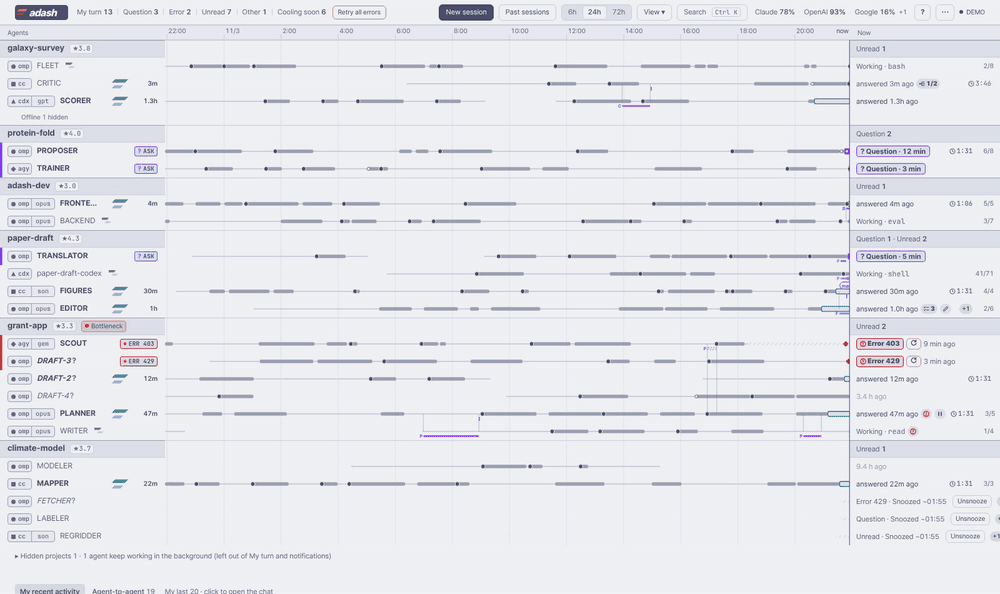

When you run ten agents at once, one finished twenty minutes ago and is waiting for your answer, another asked a question, a third stopped on a provider error, and its prompt cache is about to expire. adash watches every agent and puts the one that needs you next at the top.

It is one Rust binary. It runs your agents in its own tmux server, reads their session files, and serves a web UI at `http://127.0.0.1:7878`. Everything stays on your machine.

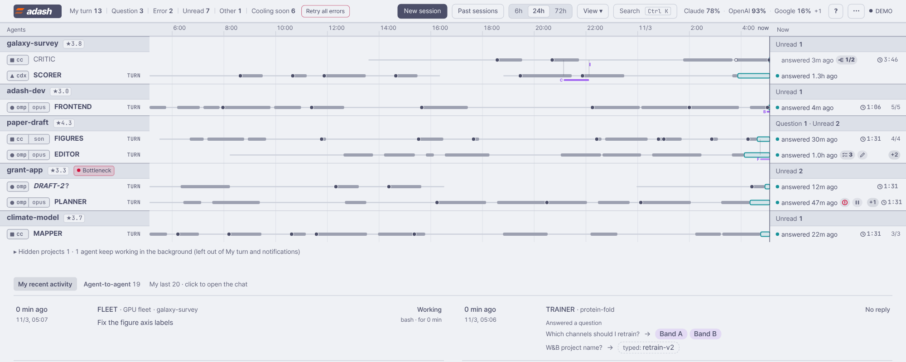

## What it shows

- **My turn**: agents waiting on you, ranked: open questions first, then provider errors, answers you have not read (soonest cache expiry first), then everything else.
- **Timeline**: what every agent did over the last 6 / 24 / 72 hours, with your messages and agent-to-agent review requests drawn as arrows.
- **Chat**: the agent's conversation rendered from its session file (Markdown, math, Mermaid, images), a composer with slash commands, `@` file completion and attachments (paste, drop or pick any files — PDFs, text, archives, images; up to 100 MB each — and the agent gets their paths), answers to multiple-choice questions, and "decisions for you" pulled out of the agent's last answer.
- **Usage**: context fill, session cost and tokens, compactions, and the account's 5-hour / weekly limits; an hourly graph of the session (tokens by kind as stacked bars, cost, tool calls and your messages) over 6 h / 24 h / 48 h / the whole session.
- **Prompt cache countdown** per agent, with the TTL that harness actually uses.
- **Errors and network**: provider errors (403, 429, connection resets) with a one-click retry; provider reachability probes that hold automatic sends while the network is down and retry errored agents once it is back.
- **Agent-to-agent**: `adash ask` / `adash reply` threads between agents, with delivery gates (never type into an agent that is working, asking, or has unsent text in its input box).
- **Analytics and reports**: a SQLite store of every session (messages, turns, tools, tokens, errors) with `adash stats`, full-text search, and weekly/monthly HTML/PDF reports.
- **Projects**: hide a project for an hour, for today or until you show it again (its agents keep working but leave your queue and notifications); close all its agents at once (working agents and unsent drafts need confirmation); archive it and later restore it and reopen its sessions. Give a project a goal, deadline and impact / leverage / cost to rank it with a ★ score, and keep a list of your own tasks next to the agents waiting on you; see [docs/projects.md](docs/projects.md).
- **Phone access** through `tailscale serve`, with per-device approval.
- **Themes**: 42 built in (adash's own plus Dracula, Catppuccin, Tokyo Night, Nord, Gruvbox, Solarized, Rosé Pine, Kanagawa, Everforest, GitHub, Modus, One, Ayu, Flexoki, Nightfox, and an Okabe–Ito pair whose state colors stay apart under simulated color blindness; from their published palettes); your own as small TOML files, checked for contrast and reloaded on save; or `adash theme import` your terminal's or editor's colors:

  | source | auto-detected | otherwise pass |
  |---|---|---|
  | Ghostty, kitty, Alacritty | the current config and its includes | a config file |
  | VS Code (also VSCodium, Cursor) | the active `workbench.colorTheme` | a theme JSON |
  | base16 / base24 | a scheme name in a tinted-theming checkout | a scheme YAML |
  | WezTerm | a literal `color_scheme = "…"` line, schemes in `~/.config/wezterm/colors` | a scheme TOML |
  | iTerm2 | — | an `.itermcolors` file |

  See [docs/themes.md](docs/themes.md).
- **English and Korean UI**.

| | |
|---|---|
| 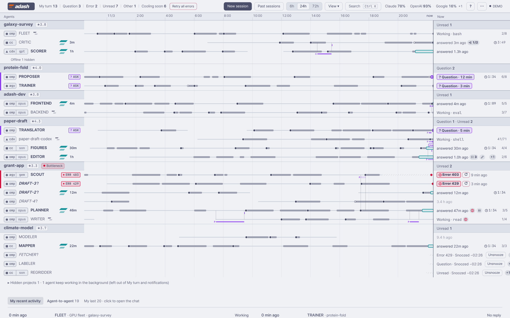 | 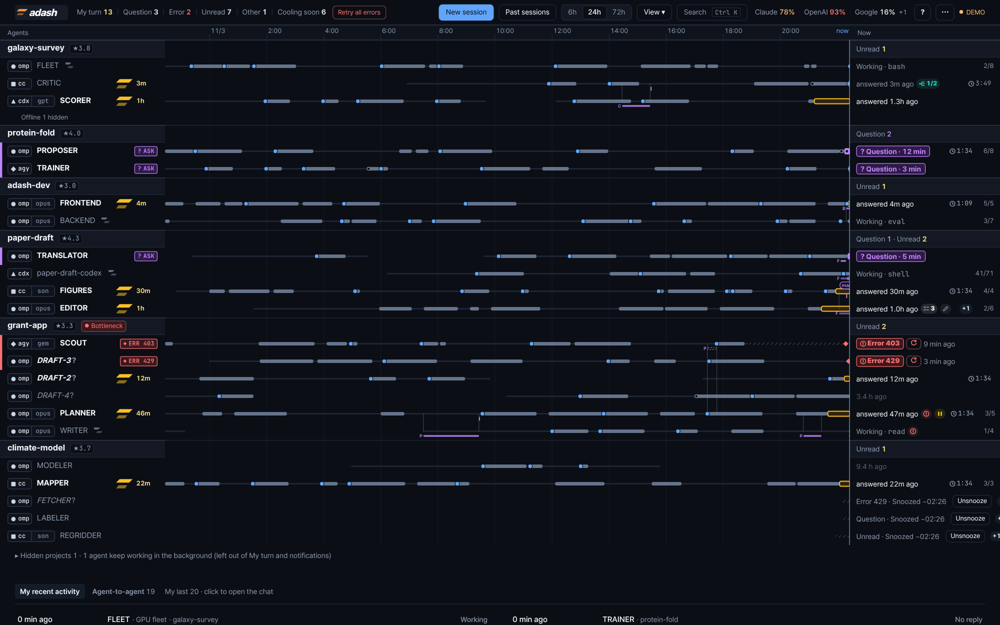 |
| 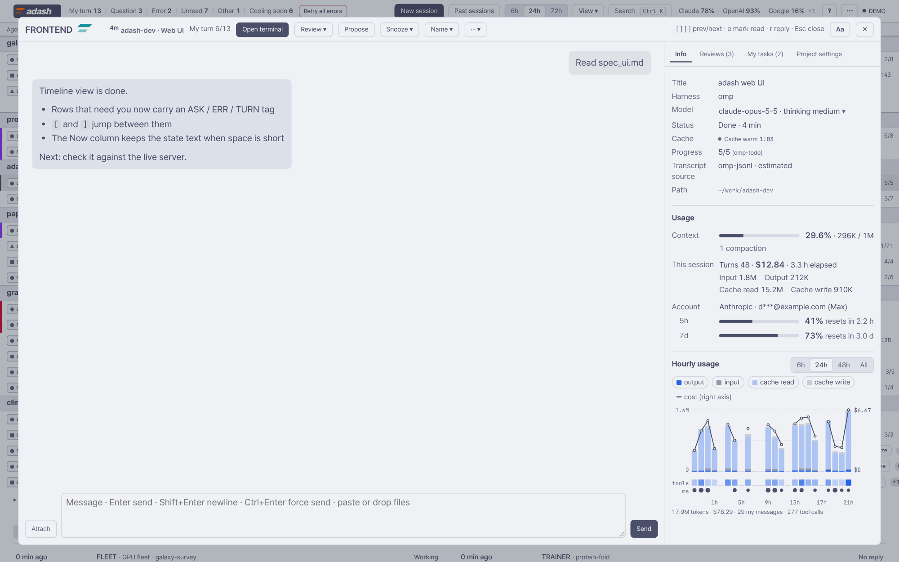 | 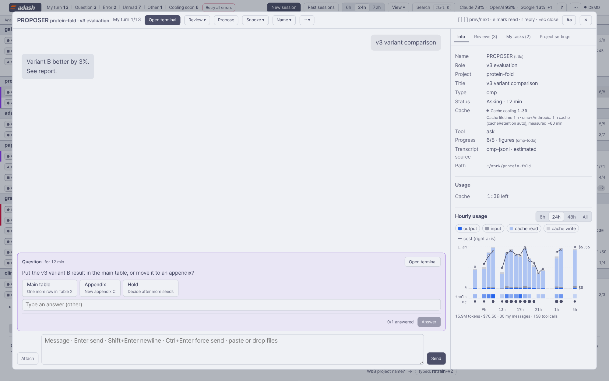 |
| 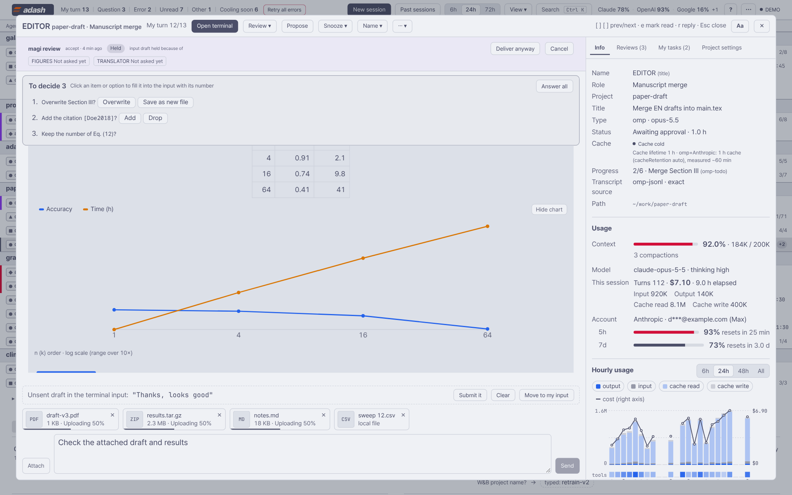 | 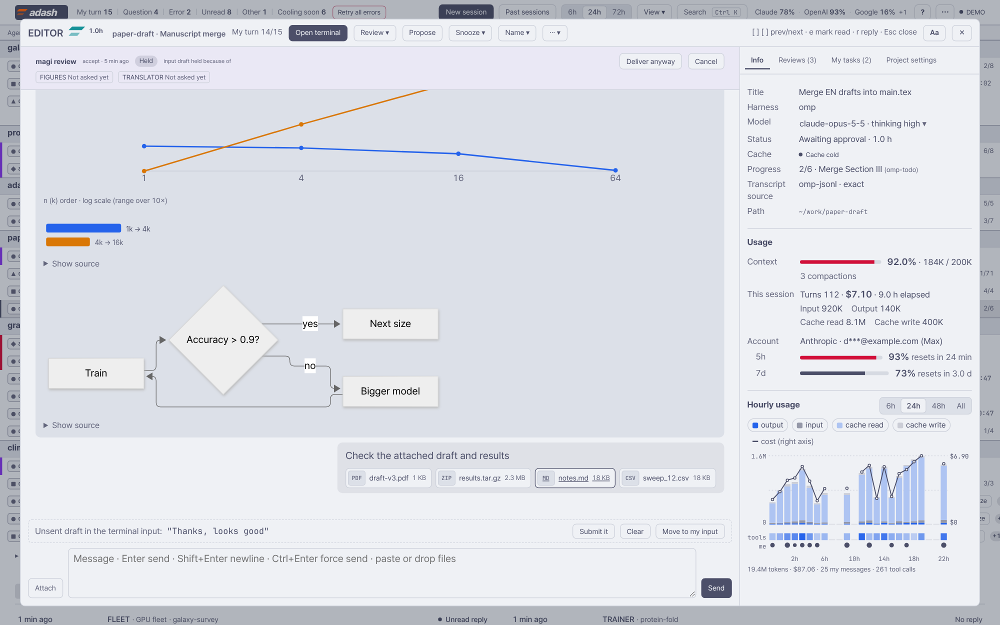 |
| 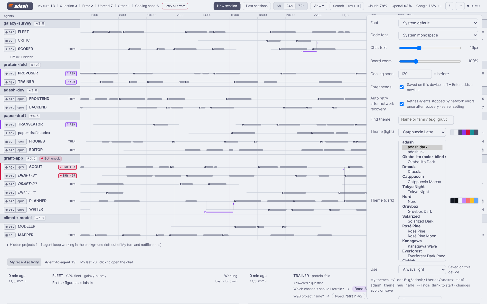 | 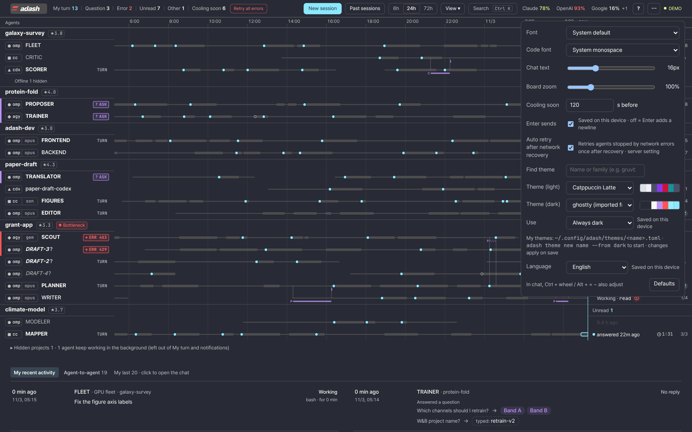 |
| 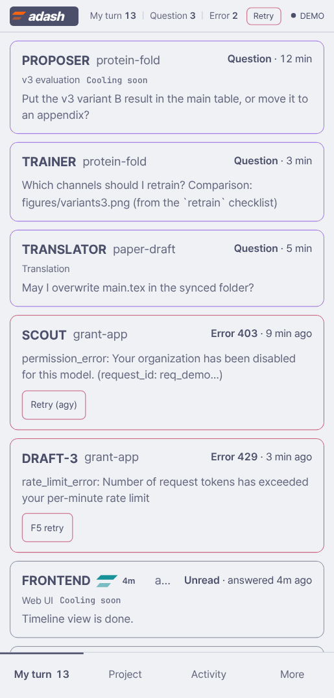 | |

## Try it without agents

```sh
cargo install adash
adash demo            # http://127.0.0.1:7879 — built-in sample data with simulated activity
```

The demo serves the dashboard from sample data in your browser; it reads nothing from your machine and sends nothing anywhere.

## Quick start

Prerequisites:

- Linux or macOS (see [Platforms](#platforms))
- tmux ≥ 3.0
- at least one agent harness: [omp](https://github.com/can1357/oh-my-pi), Claude Code, Codex CLI, or Antigravity (`agy`)
- optional: Chromium/Chrome (PDF reports), `notify-send` / `terminal-notifier` (desktop notifications), Tailscale (phone access), `zstd` (compressed backups)

```sh
cargo install adash           # or a release binary, or from source (see Install)
adash config init             # optional: writes a commented config.toml
adash install-service         # starts the tmux server and `adash serve` as per-user services
open http://127.0.0.1:7878    # xdg-open on Linux
```

Start agents from the dashboard ("New session"), or in a terminal:

```sh
adash term new --cwd ~/work/my-project --command "claude"
tmux -L adash attach -t my-project      # look at a project's terminals directly
```

adash only manages agents running in its own tmux server (`tmux -L adash`); every terminal there gets a stable handle exported as `ADASH_HANDLE`. Agents started in your own terminals are not shown.

### Install

- **crates.io**: `cargo install adash` (Rust ≥ 1.87).
- **binaries**: [GitHub Releases](https://github.com/Axect/adash/releases) has `adash-<version>-<target>.tar.gz` with a `.sha256` file for `x86_64-unknown-linux-gnu`, `aarch64-unknown-linux-gnu`, `x86_64-apple-darwin` and `aarch64-apple-darwin`; each archive holds the `adash` binary, `LICENSE`, `NOTICE` and `README.md`.
- **from source**: `git clone https://github.com/Axect/adash && cargo install --path adash`.
- **service**: `adash install-service` writes systemd user units on Linux (`~/.config/systemd/user/adash-tmux.service`, `adash.service`) and launchd agents on macOS (`~/Library/LaunchAgents/dev.adash.adash-tmux.plist`, `dev.adash.adash.plist`). The tmux server runs as its own service, so restarting or upgrading adash never kills your agents.

## Harness support

| Feature | omp | Claude Code | Codex CLI | Antigravity |
|---|---|---|---|---|
| State (working / waiting / done) | ✓ | ✓ | ✓ | ✓ |
| Conversation view | ✓ | ✓ | ✓ | ✓ |
| Questions (answer from the dashboard) | ✓ (`ask`) | ✓ (`AskUserQuestion`) | — | — |
| Provider error detection | ✓ | ✓ | ✓ | — |
| Retry after an error | F5 (retry key) | "continue" message | "continue" message | "continue" message |
| Usage (context, cost, limits) | ✓ | context, tokens | context, tokens, limits | — |
| Change model / effort from the dashboard | both (session-only model picker, `/effort`) | both (`/model`, `/effort`; also saved as Claude Code's default) | both (`/model … --reasoning=`, this session) | — |
| Slash commands / skills menu | ✓ | ✓ | ✓ | ✓ |
| `@` file references | `@path` (read by the harness) | `@path` | plain path | plain path |
| Side questions (`/btw`) | ✓ | — | — | — |
| Close / reopen on the same session | ✓ | ✓ | ✓ | close ✓, reopen untested |
| Analytics ingest | ✓ | ✓ | ✓ | ✓ |
| Tested version | 18.15.0 | 2.1.316 | 0.164.0 | 1.4.12 |

`adash harnesses` lists which harnesses are enabled and the versions each adapter was tested with. Session formats are not stable APIs. When a harness changes its format, the affected view degrades (for example, the chat falls back to the terminal screen) rather than failing.

## Configuration

Two files in the config directory (Linux `$XDG_CONFIG_HOME/adash` or `~/.config/adash`; macOS `~/Library/Application Support/adash` unless `XDG_CONFIG_HOME` is set):

- `config.toml` — machine settings, written with comments by `adash config init` (JSON Schema: [docs/schema/config.schema.json](docs/schema/config.schema.json); editors with taplo validate it). `adash config show` prints the effective values. A `config.yaml` from an earlier build is converted once and kept as `config.yaml.migrated`.

  | key | default | meaning |
  |---|---|---|
  | `port` | `7878` | HTTP port (`ADASH_PORT` wins) |
  | `harnesses.<name>` | `true` | recognize omp / claude / codex / antigravity |
  | `terminal.emulator` | `auto` | opened by "open terminal" when no tmux client is attached (`ADASH_TERMINAL` wins). `auto`: `$TERMINAL`, then the first installed of x-terminal-emulator, ghostty, kitty, wezterm, alacritty, foot, konsole, gnome-terminal, xfce4-terminal, xterm (macOS: Ghostty, iTerm, Terminal). When none is found the dashboard offers the `tmux -L adash attach -t <project>` command to copy |
  | `terminal.tmux` | `tmux` | tmux binary |
  | `notifications.backend` | `auto` | `notify-send`, `terminal-notifier`, `osascript` or `none` |
  | `notifications.silenceHarness` | `true` | turn off the agents' own desktop notifications in adash terminals so each event notifies once, from adash: omp via `PI_NO_DESKTOP_NOTIFY=1` in the terminal environment, Claude Code via `--settings '{"preferredNotifChannel":"notifications_disabled"}'`, Codex via `-c tui.notifications=false`. Your config files are not changed and agents started outside adash keep their notifications. Antigravity has no documented switch. |
  | `open.markdownApp` | unset | app for Markdown files opened from chat |
  | `reports.chrome` | unset | Chromium for PDF reports (searched on PATH when unset) |
  | `magi.skill` | unset | SKILL.md of a multi-agent review skill; the magi feature is off when unset |
  | `network.enabled`, `network.probes` | on, one URL per provider | reachability probes |
  | `mobile.tailscale` | `true` | accept phones through `tailscale serve` |

- `meta.yaml` — edited from the dashboard: projects (goal, impact, leverage, cost, deadline, note; see [docs/projects.md](docs/projects.md)), your own tasks, prompt-cache TTLs per harness/provider, and the tailnet logins allowed on phones.

Data lives in the data directory (Linux `~/.local/share/adash`, macOS `~/Library/Application Support/adash`): the analytics store, threads, uploads, reports, approved devices.

## Phone access

Run `tailscale serve --bg 7878` on the machine. Open the tailnet URL on your phone; the first visit shows a code that you approve on the desktop dashboard. Only logins listed in `meta.yaml` (default: the tailnet owner) can ask for approval. An approved phone can read the dashboard, chat with agents and answer questions; it cannot change the login allowlist, and it can open only images, PDFs and text files on the desktop. See [docs/security.md](docs/security.md).

## Privacy

adash runs locally and binds to `127.0.0.1`. It reads session files written by your agents and the tmux server it owns; it sends keystrokes only to agents in that tmux server, and only when you (or an agent-to-agent thread you started) ask it to. It makes outbound requests only for provider reachability probes (HEAD/GET to the provider API hosts, no credentials) and Web Push to your approved phones. Nothing else leaves the machine.

## Platforms

| Platform | Status |
|---|---|
| Linux x86_64 / aarch64 | supported (systemd user services, `/proc`, `notify-send`) |
| macOS x86_64 / aarch64 | supported (launchd, `sysctl`/`lsof`, `osascript`/`terminal-notifier`, Terminal.app); built and unit-tested in CI on Intel and Apple Silicon. Bug reports from real Macs are welcome. |

## Limitations

- Agents must run inside adash's tmux server.
- Session formats of the harnesses change without notice; see the tested versions above.
- The UI is optimized for desktop browsers (≥ 1280 px) and phones (≥ 360 px).

## Documentation

- [docs/architecture.md](docs/architecture.md) — data sources, poll loop, transcript mapping, analytics store, agent-to-agent protocol
- [docs/security.md](docs/security.md) — threat model and guards
- [docs/analytics.md](docs/analytics.md) — analytics schema and queries
- [docs/themes.md](docs/themes.md) — theme files and tokens
- [docs/projects.md](docs/projects.md) — project settings, ★ score, hide / close / archive, your tasks
- [CONTRIBUTING.md](CONTRIBUTING.md), [SECURITY.md](SECURITY.md), [CHANGELOG.md](CHANGELOG.md)

## License

Apache-2.0. See [LICENSE](LICENSE) and [NOTICE](NOTICE) (bundled KaTeX, markdown-it, markdown-it-texmath and Mermaid are MIT).
