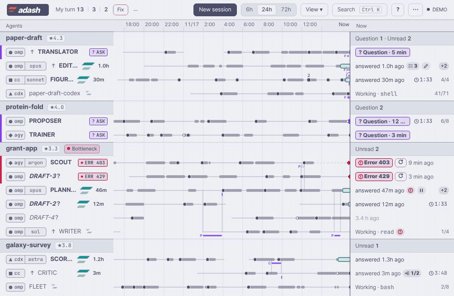
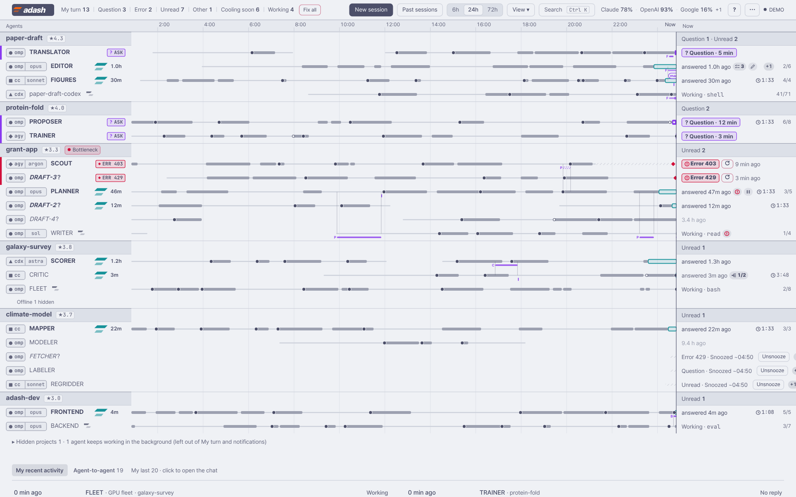

<h1 align="center">
  
</h1>

<h3 align="center">Your agents aren't the bottleneck. You are.</h3>

<p align="center">
  A local dashboard for omp, Claude Code, Codex and Antigravity that shows which agent is waiting on you.
</p>

<p align="center">
  <a href="https://github.com/Axect/adash/actions/workflows/ci.yml"></a>
  <a href="https://crates.io/crates/adash"></a>
  <a href="LICENSE"></a>
</p>

<p align="center"><a href="#try-it-in-30-seconds">Try it</a> · <a href="#quick-start">Quick start</a> · <a href="#harness-support">Harness support</a> · <a href="#defaults-that-act-on-their-own">Defaults</a> · <a href="#documentation">Documentation</a></p>



*Demo data: open the agent at the top of My turn, answer its question in the browser, press `]` for the next one.*

adash puts every coding agent that needs you (an open question, a provider error, an answer you have not read) in one queue in your browser, where you can read the conversation and reply. It shows the agents running in its own tmux server (`tmux -L adash`, with its own `tmux.conf`; your `~/.tmux.conf` and your harness configs are not touched), and you can still attach to them from any terminal with `tmux -L adash attach`. Agents started in other terminals are not shown; [resume them inside adash](#bring-an-existing-session-in).

## Try it in 30 seconds

Download a binary for Linux or macOS (x86_64, aarch64) from [Releases](https://github.com/Axect/adash/releases), or install with Cargo (Rust 1.87 or newer):

```sh
cargo install adash
adash demo            # http://127.0.0.1:7879, built-in sample data with simulated activity
```

The demo reads nothing from your machine and sends nothing anywhere.

## The core loop

1. **Queue.** My turn ranks the agents waiting on you: open questions first, then provider errors, then answers you have not read, the one whose prompt cache is estimated to expire soonest first.
2. **Answer or retry in the browser.** Pick an option on the question card or type a reply; a provider error has a one-click retry.
3. **Next.** `]` and `[` move to the next and previous agent in the queue; `e` marks an answer read.



*The board: the agents waiting on you at the top, what each agent did over the last 24 hours on the right.*

## Harness support

| Feature | omp | Claude Code | Codex CLI | Antigravity |
|---|---|---|---|---|
| State (working / waiting / done) | ✓ | ✓ | ✓ | ✓ |
| Conversation view | ✓ | ✓ | ✓ | ✓ |
| Questions (answer from the dashboard) | ✓ (`ask`) | ✓ (`AskUserQuestion`) | — | — |
| Provider error detection | ✓ | ✓ | ✓ | ✓ |
| Retry after an error | F5 (its retry key) | message `continue` | message `continue` | message `continue` |
| Usage (context, cost, limits) | ✓ | context, tokens, limits | context, tokens, limits | limits |
| Change model / effort from the dashboard | both | both | both | — |
| Slash commands / skills menu | ✓ | ✓ | ✓ | ✓ |
| `@` file references | `@path` | `@path` | plain path | plain path |
| Side questions (`/btw`) | ✓ | — | — | — |
| Close / reopen on the same session | ✓ | ✓ | ✓ | ✓ |
| Analytics ingest | ✓ | ✓ | ✓ | ✓ |
| Tested version | 18.13–18.20 | 2.1 | 0.16x | 1.4–1.5 |

The retry message is `continue` while the dashboard is in English and `계속 진행해` while it is in Korean; `[retry] message` in `config.toml` sets your own. Limits are the provider's 5-hour and weekly windows in the top bar, read from `omp usage` when omp reports that provider, else from `claude -p /usage`, Codex's session files or `agy -p /usage` (none of these calls a model). `adash harnesses` lists the enabled harnesses and the tested versions. Session formats are not stable APIs: when a harness changes its format, the affected view falls back (for example, the chat shows the terminal screen) instead of failing.

## Quick start

You need tmux 3.0 or newer and at least one harness: [omp](https://github.com/can1357/oh-my-pi), Claude Code, Codex CLI or Antigravity (`agy`). Optional: Chromium or Chrome (PDF reports), `notify-send` / `terminal-notifier` (desktop notifications), Tailscale (phone access), `curl` (phone notifications), `zstd` (compressed backups).

```sh
adash config init             # optional: writes a commented config.toml
adash install-service         # starts the tmux server and the dashboard as per-user services
xdg-open http://127.0.0.1:7878   # macOS: open
```

`install-service` writes systemd user units on Linux (`~/.config/systemd/user/adash-tmux.service`, `adash.service`) and launchd agents on macOS (`~/Library/LaunchAgents/dev.adash.adash-tmux.plist`, `dev.adash.adash.plist`). The tmux server is its own service, so restarting or upgrading the dashboard never ends your agents.

Start agents with **New session** in the dashboard, or from a terminal:

```sh
adash term new --cwd ~/work/my-project --command "claude"
tmux -L adash attach -t my-project      # the project's terminals, directly
```

### Bring an existing session in

Resume it inside adash, then close the old terminal:

```sh
adash term new --cwd ~/work/my-project --command "claude --resume"   # picker
adash term new --cwd ~/work/my-project --command "codex resume"      # picker
adash term new --cwd ~/work/my-project --command "omp --resume"      # picker
```

### Uninstall

Stopping the dashboard and stopping its tmux server are different: the tmux server holds your agents.

```sh
adash uninstall-service           # stop and remove the dashboard service; agents keep running
adash uninstall-service --tmux    # also the tmux server: ends every agent terminal (asks first)
cargo uninstall adash             # or delete the binary
```

Your config (`~/.config/adash`) and data (`~/.local/share/adash`; on macOS both under `~/Library/Application Support/adash`) are kept; delete them by hand to remove everything.

## Defaults that act on their own

| What | Default | Key |
|---|---|---|
| Agents stopped by a network error are retried once their provider is reachable again | on | `autoRetryOnNetworkRecovery` in `meta.yaml` |
| Agents started from the dashboard (or by an agent in its own folder) accept the harness's "trust this folder?" prompt | on | `launch.autoTrust` |
| Agents done or idle for 24 hours are closed and shown as asleep; a message reopens the same session | on | `sleep.enabled`, `sleep.afterHours` |
| adash sends the notifications; the agents' own desktop notifications are turned off in its terminals | on | `notifications.silenceHarness` |

See [docs/configuration.md](docs/configuration.md) for every setting.

## Privacy

adash binds to `127.0.0.1` and keeps its data on your machine. Its own network use is limited to provider reachability checks (HEAD/GET to provider API hosts, no credentials), usage queries run through your installed harnesses, and, if you set it up, phone access through `tailscale serve` with Web Push to approved phones. It types only into agents in its own tmux server: when you send something, when a thread between agents you started delivers, and through the defaults above. Your agents keep their own network behavior. See [docs/security.md](docs/security.md).

## More

- **Conversation**: Markdown, math, Mermaid and images from the session file; slash commands, `@` file completion and file attachments up to 100 MB.
- **Decisions**: when an agent ends its answer with a `## Decisions` list, each `label: A / B / C` item becomes a row of buttons.
- **Prompt cache**: an estimated countdown per agent (last activity plus a per-harness TTL; not a time the provider reports).
- **Agent-to-agent**: `adash ask` / `adash reply` threads that never type into an agent that is working, asking, or has unsent text.
- **Usage and analytics**: context, cost and tokens per session, a SQLite store of every session (`adash stats`, search), weekly and monthly HTML/PDF reports.
- **Phone**: the dashboard through `tailscale serve`, with per-device approval.
- **Projects and themes**: hide, close and archive projects ([docs/projects.md](docs/projects.md)); 42 themes or your terminal's colors ([docs/themes.md](docs/themes.md)); English and Korean UI.

## Platforms

| Platform | Status |
|---|---|
| Linux x86_64 / aarch64 | supported (systemd user services, `/proc`, `notify-send`) |
| macOS x86_64 / aarch64 | built and unit-tested in CI; not yet run on a real Mac (launchd, `sysctl`/`lsof`, `osascript`/`terminal-notifier`). Reports welcome |
| Windows | not supported natively; WSL2 untested |

## Limitations

- Agents must run inside adash's tmux server.
- Harness session formats change without notice; see the tested versions.
- The UI is made for desktop browsers (1280 px and wider) and phones (360 px and wider).

## Documentation

- [docs/configuration.md](docs/configuration.md): every setting, `meta.yaml`, data
- [docs/architecture.md](docs/architecture.md): data sources, poll loop, transcript mapping, analytics store, agent-to-agent protocol
- [docs/security.md](docs/security.md): threat model and guards
- [docs/analytics.md](docs/analytics.md): analytics schema and queries
- [docs/themes.md](docs/themes.md): theme files, tokens and importing your terminal's colors
- [docs/projects.md](docs/projects.md): project settings, hide / close / archive, your tasks
- [CONTRIBUTING.md](CONTRIBUTING.md), [SECURITY.md](SECURITY.md), [CHANGELOG.md](CHANGELOG.md)

## License

Apache-2.0. See [LICENSE](LICENSE) and [NOTICE](NOTICE) (bundled KaTeX, markdown-it, markdown-it-texmath and Mermaid are MIT).
