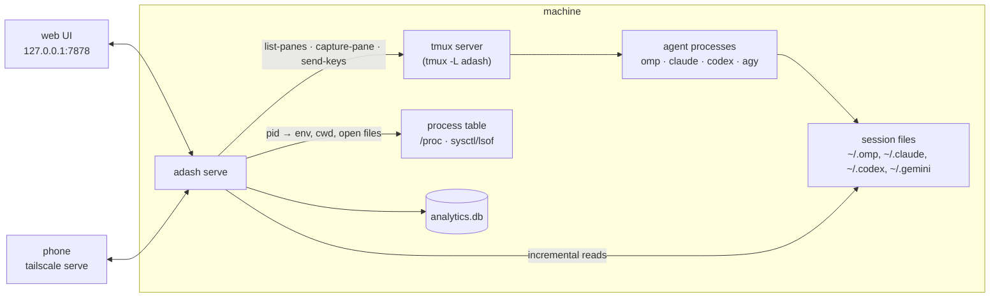

# Architecture

adash is one binary (`adash`) with three roles: the server (`adash serve`), a CLI that talks to the server (or works directly when it is down), and the demo (`adash demo`).

## Sources

- **tmux**: adash owns a private tmux server (`tmux -L adash`) started by its own per-user service. Every terminal carries a handle `t_<8 hex>` (pane option `@adash_handle`, env `ADASH_HANDLE`). `list-panes` gives title, cwd, pid and last output time; `capture-pane` gives the screen.
- **Processes**: agent processes are found by command line (`omp`, `claude`, `codex`, `agy`) and tied to a terminal through `ADASH_HANDLE` in their environment. Linux reads `/proc`; macOS uses `sysctl(KERN_PROCARGS2)`, `ps` and `lsof` (`src/platform.rs`).
- **Session files**: each harness writes a JSONL log (Antigravity: a SQLite database of protobuf steps). adash reads them incrementally by byte offset and never writes them.

## Harness adapters

Everything that differs between omp, Claude Code, Codex and Antigravity sits behind the `Harness` trait (`src/harness.rs`): process detection, session discovery, transcript parsing, turn state, questions, provider errors, retry action, input prefixes, `@` mentions, usage, resume and exit commands, and tested versions. When a session file yields nothing the adapter recognizes, adash logs it once per harness and shows the terminal screen.

A new agent's session file usually appears only after its first message. Until then the chat is empty (`source: "pending"`, with the launch prompt if any), and a 1 s watcher on the harness's session directory maps the file as soon as it is created.

## Mapping a terminal to its session

A terminal's agent process is matched to its session file in order of confidence: the file the process holds open (or its `--resume` argument), then a pinned earlier match for the same process (pid + start time), then the terminal title against the session's title record, then the file whose last assistant text matches the screen. Subagent files map to their main session. The matched file is the agent's **identity**: names, acknowledgements and history are keyed by it, so they survive closing the pane.

## Poll loop

Every 3 s the server builds a snapshot: terminals, processes, mapped sessions, per-agent state (working / waiting / asking / error), the open question if any, decisions in the last answer, the prompt-cache countdown, and usage. The snapshot drives `/api/state`, desktop and push notifications on transitions, and the delivery of held agent-to-agent messages. A 10 s background loop handles drafts, magi runs and agent-to-agent threads started outside the dashboard. The analytics loop ingests new session bytes every minute.

Each loop round runs under `catch_unwind`; locks recover from poisoning; every external command has a deadline.

## Conversation view

`GET /api/agents/{name}/transcript` parses the session file per harness into messages (user, assistant, tool, system, shell, error, side questions) with a cursor so the browser fetches only what is new. Without a session file the chat shows the terminal screen.

## Questions

When an agent shows a question (omp `ask`, Claude `AskUserQuestion`), the dashboard renders the options; an answer drives the harness's own dialog with keystrokes, checks the screen after every step, and confirms the result from the session file.

## Agent-to-agent threads

`adash ask <agent> --file brief.md` creates a thread: a request file, a pointer line delivered to the target (`[adash <id>] … 을 읽고 답해줘`), the target's `adash reply <id> --file reply.md`, and a relay line back to the requester. Delivery goes through the gates in [security.md](security.md); a thread that bounces too often escalates to the human. Review scripts that message agents directly can register their exchange with `adash thread register` so it is drawn on the timeline.

## Analytics store

`analytics.db` (SQLite, WAL) holds append-only facts with natural keys, so re-reading a file never double counts: sessions, human messages, turns, tool calls, token usage, questions, provider errors, state transitions, notifications and dashboard actions. Schema and queries: [analytics.md](analytics.md). Reports (`adash report`) render HTML (and PDF through headless Chromium) from it.

## Web UI

Plain JavaScript and CSS embedded into the binary (`web/`), with vendored markdown-it, KaTeX and Mermaid. `?fixture=1` runs the UI on built-in sample data with simulated activity; `adash demo` serves exactly that.
